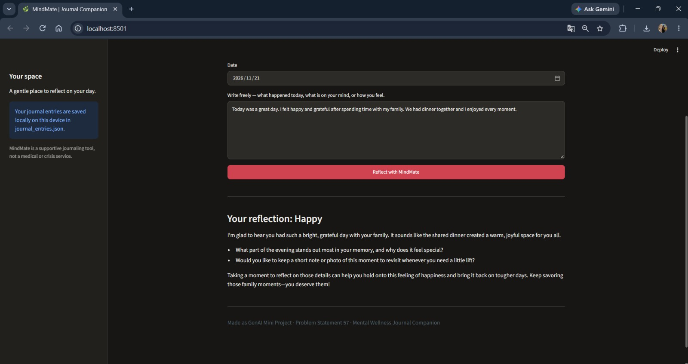

# MindMate – Mental Wellness Journal Companion (PS 57)

A simple GenAI journaling app for students. Users write a journal entry, receive a supportive AI reflection, see an approximate mood label, and save entries locally.

## Features
- Journal entry form with date
- Supportive response using Gemini 2.5 Flash
- Local keyword-based mood estimate
- Distress-language flag with India support resources (Tele-MANAS 14416 / 1-800-891-4416; emergency 112)
- Local journal history with delete option
- Safe fallback response if the API key is missing or the API is unavailable

## Setup
1. Install Python 3.10 or newer.
2. Open this folder in VS Code / terminal.
3. Create and activate a virtual environment (optional but recommended).
4. Install dependencies:
   ```bash
   pip install -r requirements.txt
   ```
5. Get a Gemini API key from Google AI Studio.
6. Set the key as an environment variable:
   - PowerShell: `$env:GEMINI_API_KEY="YOUR_KEY_HERE"`
   - macOS/Linux: `export GEMINI_API_KEY="YOUR_KEY_HERE"`
7. Run:
   ```bash
   streamlit run app.py
   ```

The app also runs without an API key using a local safe fallback response, so you can test the UI first.

## Files
- `app.py` – Streamlit interface
- `ai_helper.py` – Gemini API call and fallback
- `journal.py` – mood flagging and local JSON storage

## Safety and privacy
This is an educational prototype, not a medical device, diagnostic tool, therapy service, or crisis service. Mood labels and distress flags are approximate keyword-based checks and may miss context. Do not enter highly sensitive personal information. Entries are stored in `journal_entries.json` on the machine running the app. The project displays India support contacts when selected distress-related terms are detected; in an immediate emergency, contact local emergency services.

## Problem statement
PS 57 – Mental Wellness Journal Companion: Students feel stressed but do not reflect. Build a journaling app that responds supportively and shares helpline information when needed.


## Application Screenshots

### 1. AI Supportive Response


### 2. Distress Detection and Support Information


