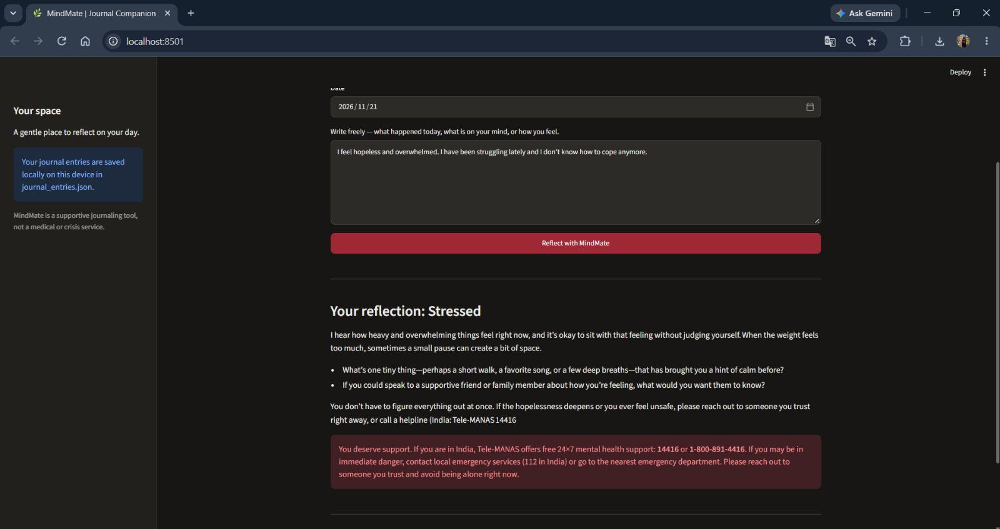

# MindMate – Mental Wellness Journal Companion (PS 57)

MindMate is a GenAI-powered journaling application designed for students. Users can write daily journal entries, receive supportive AI-generated reflections, view an approximate mood label, and save their entries locally.

## Features

- Journal entry form with date selection
- Supportive AI-generated responses using Groq API
- Local keyword-based mood estimation
- Distress-language detection with India support resources (Tele-MANAS: 14416 / 1-800-891-4416; Emergency: 112)
- Local journal history with delete option
- Safe fallback response if the API key is missing or the API is unavailable

## Technology Stack

- **Programming Language:** Python
- **User Interface:** Streamlit
- **LLM Provider:** Groq API
- **Model:** openai/gpt-oss-120b
- **Libraries:** groq, python-dotenv, Streamlit
- **Storage:** Local JSON file

## Setup and Installation

1. Install Python 3.10 or newer.
2. Clone this repository or open the project folder in VS Code.
3. Create and activate a virtual environment (recommended).
4. Install the required dependencies:

   ```bash
   pip install -r requirements.txt
   ```

5. Get a Groq API key from the Groq Console.
6. Create a `.env` file in the project folder and add your API key:

   ```env
   GROQ_API_KEY=your_groq_api_key_here
   ```

7. Run the application:

   ```bash
   streamlit run app.py
   ```

The application also provides a fallback response when the API key is unavailable, allowing users to test the interface.

## Project Structure

- `app.py` – Streamlit user interface
- `ai_helper.py` – Groq API integration and fallback response
- `journal.py` – Mood estimation, distress detection and local journal storage
- `requirements.txt` – Project dependencies
- `.env.example` – Example environment configuration
- `screenshots/` – Application output screenshots

## Problem Statement

**PS 57 – Mental Wellness Journal Companion**

Students often experience stress but may not take time to reflect on their feelings. The objective is to build a journaling application that responds supportively to journal entries and shares helpline information when distress-related language is detected.

## Application Screenshots

### 1. AI Supportive Response


### 2. Distress Detection and Support Information



## Safety and Privacy

MindMate is an educational prototype, not a medical device, diagnostic tool, therapy service or crisis service.

Mood labels and distress flags are approximate keyword-based checks and may miss context. Users should avoid entering highly sensitive personal information. Journal entries are stored locally in `journal_entries.json` on the machine running the application.

The application displays India-specific support contacts when selected distress-related terms are detected. In an immediate emergency, contact local emergency services.

## Developer

**Name:** Virti Ramesh  
**Roll No.:** 57  
**Class:** B.Tech Computer Science – AI & Analytics
